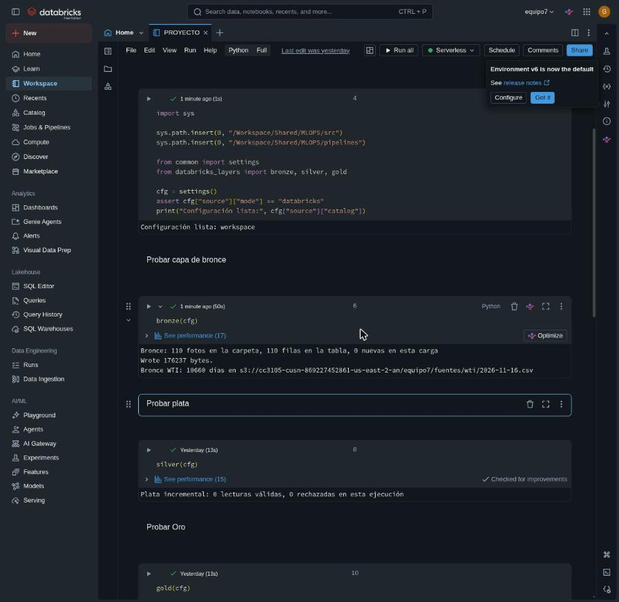

# Capa Bronce (Gustavo Cruz)

Código: [`pipelines/01_bronze.py`](../../pipelines/01_bronze.py) → `bronze()` en [`pipelines/databricks_layers.py`](../../pipelines/databricks_layers.py).

## Qué hace

1. Lee las fotos de `BRONZE_INPUT_URI` (`img/`, recursivo) con Spark `binaryFile` por la external location del bucket Bronce. Filtra `heic/jpg/jpeg/png`.
2. Escribe el Delta `s3://<bucket-bronce>/equipo7/fotos_precios` con `path`, `modificationTime`, `length`, `content`, `_ingestion_timestamp` y `_source_file`, y lo copia a `workspace.equipo7.bronze_fotos_precios`.
3. **Incremental:** `MERGE` por `path` y solo inserta las fotos nuevas. Al volver a ejecutar no se duplica nada.
4. **Criterio de aceptación verificado en cada ejecución:** si falta alguna foto de la carpeta o hay un `path` duplicado, la tarea falla. Imprime `N fotos en la carpeta, N filas en la tabla, K nuevas`.
5. **Fuente complementaria (opcional del enunciado):** el precio diario del petróleo WTI desde FRED (`DCOILWTICO`).
   - Se guarda el CSV original en `equipo7/fuentes/wti/AAAA-MM-DD.csv`.
   - La tabla `bronze_petroleo_wti` tiene las columnas `observation_date` y `DCOILWTICO` como texto, más las columnas de auditoría. Se reemplaza en cada carga, lo que la hace idempotente.
   - Si FRED no responde, se omite sin detener la carga de fotos. Si cambia el formato del CSV, la tarea falla.

## Decisiones

- `MERGE` por `path` en lugar de Auto Loader: es más simple, cumple el criterio y no requiere un checkpoint. Una foto reemplazada con la misma ruta **no** se vuelve a cargar.
- WTI y no el histórico del MEM: FRED ofrece un CSV estable sin llave de API. El MEM publica PDFs sin una URL fija.

## Uso en Oro

Oro ya lee `bronze_petroleo_wti` (`src/gasolina_gt/gold/weekly.py`): la convierte a número y la promedia por semana para las variables `wti_semanal` y `wti_variacion`.

## Evidencia (16/11/2026, serverless, notebook PROYECTO, Git folder en `4e37a63`)



```
Bronce: 110 fotos en la carpeta, 110 filas en la tabla, 0 nuevas en esta carga
Bronce WTI: 10660 días en s3://cc3105-cusn-869227452861-us-east-2-an/equipo7/fuentes/wti/2026-11-16.csv
```

Esta fue una recarga sobre una tabla que ya existía: entraron 0 fotos nuevas y la verificación no encontró faltantes ni duplicados. Con eso se cumple el criterio «una segunda carga no duplica fotos».

- [ ] Ejecución dentro del Job (fase 4, la configura otro integrante).
