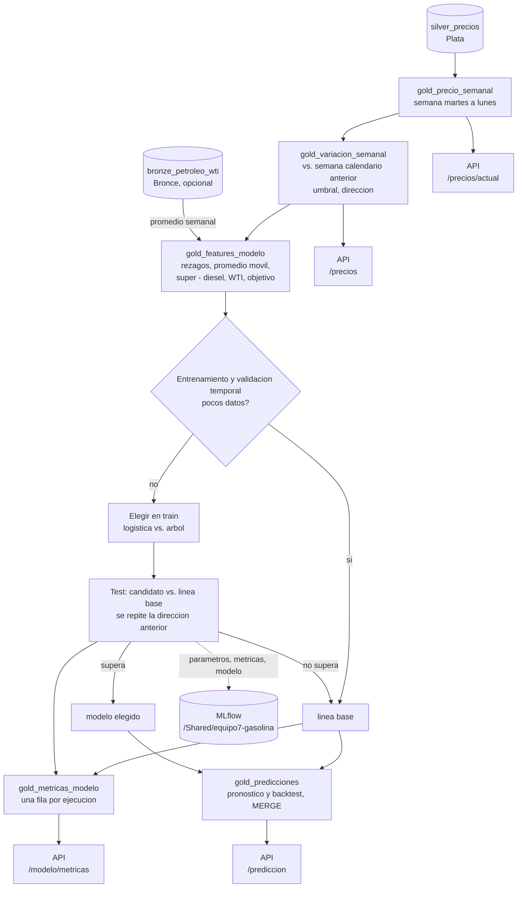

# Capa Oro (José Gramajo)

Código: [`pipelines/03_gold.py`](../../pipelines/03_gold.py) → `gold()` en [`pipelines/databricks_layers.py`](../../pipelines/databricks_layers.py). La lógica está en [`src/gasolina_gt/gold/`](../../src/gasolina_gt/gold/) y se prueba sin Spark (`tests/unit/test_gold_*.py`).

Responde la pregunta central del proyecto: **¿el precio de cada combustible sube, baja o se mantiene la semana siguiente?**

## Qué hace

1. Lee `silver_precios` (Delta en el bucket Plata) y, si existe, `bronze_petroleo_wti`. El WTI se convierte con `TRY_CAST(NULLIF(TRIM(DCOILWTICO), '') AS DOUBLE)`: en cómputo serverless rige el modo ANSI y un `CAST` simple de un día sin dato (texto vacío) lanzaría error.
2. Calcula cinco tablas Delta en `s3://bucket-oro/equipo7/` y las copia a `workspace.equipo7.gold_*` (con `_sync_managed_table`). Al final aplica los `COMMENT` de tablas y columnas. Detalle de columnas en [contrato_api.md](contrato_api.md).

| Tabla | Contenido | Escritura |
| --- | --- | --- |
| `gold_precio_semanal` | promedio, mínimo, máximo y número de lecturas por semana (martes a lunes) y combustible | reemplaza |
| `gold_variacion_semanal` | diferencia en Q y en %, `direccion` y `semana_anterior_disponible` | reemplaza |
| `gold_features_modelo` | variables y objetivo `direccion_siguiente` | reemplaza |
| `gold_predicciones` | predicción por semana, combustible y `tipo` (`backtest` o `pronostico`) | `MERGE` |
| `gold_metricas_modelo` | métricas del modelo y de la línea base, una fila por ejecución | agrega |

## Diagrama



Las tablas `gold_*` son las únicas que consume la API. El detalle de columnas y consultas está en [contrato_api.md](contrato_api.md).

## Decisiones

- **Solo semanas calendario consecutivas.** La variación se calcula contra la semana exactamente 7 días antes. Si esa semana no existe, la variación y la dirección quedan nulas y `semana_anterior_disponible = false`. Un rezago de k semanas es siempre `semana − 7k días`, nunca «la fila anterior». El código anterior usaba `lag` por fila y comparaba contra semanas de meses atrás.
- **Umbral parametrizable**, por defecto ±Q0.10. Una diferencia exactamente igual al umbral es `se_mantiene`; se redondea a 4 decimales para que 20.10 − 20.00 no cruce el umbral por error de punto flotante.
- **Variables** (todas usan solo la semana t y anteriores): variación de las últimas 4 semanas (`variacion_lag_1` es la variación de la última semana conocida), promedio móvil de 4 semanas (semanas que existan, mínimo 2), diferencia súper–diésel de la misma semana, y el WTI semanal con su variación. **Objetivo:** `direccion_siguiente`, la dirección de la semana t + 7 días.
- **Un solo modelo global** con el combustible como variable, no uno por combustible. Con 6 a 18 pares de semanas consecutivas por combustible, un modelo por combustible no tiene ejemplos para entrenar ni para probar.
- **Qué cuenta como ejemplo.** Hacen falta tres semanas seguidas (t−1, t y t+1): t−1 para conocer la dirección actual (la línea base) y t+1 para la etiqueta. Por eso hay menos ejemplos que pares. Al inicio de cada ejecución se imprime el conteo por combustible.
- **Modelos:** regresión logística y árbol de decisión (sklearn). Los valores que faltan (rezagos, WTI) se imputan con la mediana de train y se añade un indicador de «faltaba», para no perder el ejemplo.
- **Validación temporal.** Las últimas `semanas_test` semanas con ejemplos (por defecto 4) son la prueba; todo lo anterior es entrenamiento. Nunca hay mezcla aleatoria.
- **Regla de elección en dos pasos.**
  1. Entre logística y árbol se elige con tres pliegues temporales *dentro de train*, por F1 macro. El test no interviene. Si no hay semanas suficientes para validar en train, se usa la logística y se documenta como limitación.
  2. El test solo compara el candidato elegido con la línea base «se repite la dirección de la semana anterior». El candidato se usa únicamente si mejora el F1 macro y no empeora la accuracy. Si no, se usa la línea base y así se reporta.
- **Pocos datos.** Si hay menos de 20 ejemplos etiquetados, menos de 12 en train o una sola clase en train, el pipeline **no falla**: escribe las tablas descriptivas, predice con la línea base (sin probabilidad; con respaldo si hace falta, ver Predicciones), marca `modo_pocos_datos = true` y lo explica en `motivo` y en el log. Con huecos parecidos a los de las fotos reales este modo es el resultado más probable hasta que se acumulen más semanas.
- **Predicciones.** `semana` es la semana que se predice. **Siempre hay una fila `pronostico` por combustible, para la semana siguiente a SU última semana con datos** (no a la última global); si un combustible dejó de tener fotos, su pronóstico queda atrasado respecto a los demás, y eso se ve en `semana`. Con modelo entrenado, el pronóstico se reentrena con todos los ejemplos y se aplica a esa última semana (los valores que faltan se imputan). Con la línea base:
  1. si esa semana tiene dirección actual, se repite (`modelo = linea_base`);
  2. si no la tiene (llegó tras un hueco, sin semana anterior), se usa la **última dirección conocida** de ese combustible;
  3. si tampoco existe ninguna, `se_mantiene`.

  En los casos 2 y 3 el modelo se marca `linea_base_respaldo`, para que se note que es un supuesto y no una medición. Un `pronostico` ya resuelto no se reescribe: queda como registro de lo que se dijo; solo se le rellena `direccion_real` cuando llegan las fotos. El `backtest` se recalcula con el modelo actual. Clave del `MERGE`: `(semana, combustible, tipo)`.
- **MLflow** (`/Shared/equipo7-gasolina`): parámetros (umbral, semanas de test, features, hiperparámetros), métricas del modelo y de la línea base, y el modelo con `mlflow.sklearn.log_model` cuando se usa el modelo. En el Job de Databricks, una falla del registro detiene Oro antes de escribir tablas; el cálculo local puede dejar un reporte en `reports/`.

## Parámetros

Se leen en este orden: `dbutils.widgets` → argumentos CLI → variables de entorno → valor por defecto.

| Parámetro | Widget | CLI | Variable de entorno | Defecto |
| --- | --- | --- | --- | --- |
| Umbral de dirección (Q) | `umbral_q` | `--umbral-q` | `GOLD_UMBRAL_Q` | `0.10` |
| Semanas de prueba | `semanas_test` | `--semanas-test` | `GOLD_SEMANAS_TEST` | `4` |
| Experimento MLflow | `mlflow_experiment` | `--mlflow-experiment` | `GOLD_MLFLOW_EXPERIMENT` | `/Shared/equipo7-gasolina` |
| Usar WTI | `usar_wti` | `--usar-wti` | `GOLD_USAR_WTI` | `true` |
| Mínimo de ejemplos | `min_ejemplos` | `--min-ejemplos` | `GOLD_MIN_EJEMPLOS` | `20` |
| Mínimo en train | `min_train` | `--min-train` | `GOLD_MIN_TRAIN` | `12` |

### Cómo pasar los parámetros según el tipo de tarea

Un parámetro solo cuenta si **se pasó explícitamente**. Los widgets de Oro se crean **vacíos** (la etiqueta muestra el valor por defecto) y un widget vacío se ignora, de modo que nunca tapa a un argumento CLI ni a una variable de entorno.

| Tipo de tarea del Job | Cómo se pasan | Ejemplo |
| --- | --- | --- |
| **Notebook** | Parámetros de la tarea (`base_parameters`) o del Job, con el **nombre del widget** | `{"umbral_q": "0.10", "semanas_test": "4", "usar_wti": "true"}` |
| **Script Python** (`03_gold.py`) | Lista de argumentos de la tarea; llegan en `sys.argv` | `["--umbral-q", "0.10", "--semanas-test", "4", "--usar-wti", "true"]` |
| Script Python con parámetros del Job | Referenciarlos en los argumentos de la tarea | `["--umbral-q", "{{job.parameters.umbral_q}}"]` |
| Notebook interactivo | Escribir el valor en el widget de arriba, o dejarlo vacío para usar el defecto | |
| Variables de entorno | Solo donde el cómputo permita definirlas (en serverless no se pueden configurar a nivel de cómputo) | `GOLD_UMBRAL_Q=0.10` |

Los argumentos que no son de Oro (por ejemplo `--reprocess`) se ignoran, y los nombres de argumento no se abrevian (`--umbral` no vale por `--umbral-q`). Un valor inválido (umbral negativo, `semanas_test` menor que 1, `usar_wti` distinto de sí/no) detiene la tarea con un mensaje claro.

Esto sigue el comportamiento documentado de Databricks (parámetros de una tarea de notebook = widgets; argumentos de una tarea de script = `sys.argv`). Está cubierto por pruebas con `dbutils` simulado, pero **no se ha comprobado todavía en el workspace**: en la primera ejecución del Job, la primera línea de Oro imprime `Oro: parámetros GoldParams(...)` con los valores efectivos; verifique ahí que coinciden con los que pasó.

## Cómo probarlo en el notebook de prueba

`/Workspace/Shared/MLOPS` es compartida: **no pruebe ahí código sin terminar**. Use un Git folder propio de la rama `proyecto1` y apunte `sys.path` a esa copia.

```python
# Celda 1: rutas y librerías (serverless)
import sys
RAIZ = "/Workspace/Users/<su_usuario>/MLOPS"          # Git folder propio de proyecto1
sys.path[:0] = [f"{RAIZ}/src", f"{RAIZ}/pipelines"]
import sklearn, mlflow
print(sklearn.__version__, mlflow.__version__)
# Si falla el import:  %pip install scikit-learn mlflow   y luego   dbutils.library.restartPython()
```

```python
# Celda 2: ejecutar Oro (las variables DATA_SOURCE, *_URI y DATABRICKS_CATALOG ya deben estar definidas)
from common import settings
from databricks_layers import gold
gold(settings())
```

```sql
-- Celda 3: comprobar
SELECT * FROM workspace.equipo7.gold_metricas_modelo ORDER BY _generado_en DESC;
SELECT * FROM workspace.equipo7.gold_predicciones ORDER BY semana DESC, combustible, tipo;
SELECT combustible, count(*) AS semanas FROM workspace.equipo7.gold_features_modelo GROUP BY combustible;
DESCRIBE TABLE EXTENDED workspace.equipo7.gold_predicciones;   -- muestra los COMMENT
```

Para reprocesar tras corregir Plata: ejecutar el notebook `pipelines/02_silver.py` con `modo=reaplicar_reglas` o `modo=reprocesar_todo`, y luego `gold(settings())` o la tarea `03_oro` del Job. `databricks_layers.silver()` está deshabilitada. Oro vuelve a calcular todo desde Plata y es idempotente: repetirlo sin fotos nuevas no duplica ni cambia las predicciones (más una fila nueva en `gold_metricas_modelo`).

## Pruebas locales

```
pip install -e ".[dev]"      # opcional: pip install -e ".[dev,databricks]" para MLflow local
pytest -q
```

Los datos sintéticos de las pruebas viven solo en `tests/unit/gold_helpers.py`.

## Evidencia pendiente

Las capturas se guardan en `docs/oro/evidencia/` con nombres descriptivos y numerados. Los de la lista son una propuesta:

- [x] `01_triples.png`: 15 ejemplos válidos en total; se usó la línea base por falta de datos.
- [x] `02_tablas_gold.png`: consulta de `gold_predicciones`. Falta capturar comentarios y el resumen de las cinco tablas.
- [x] `03_mlflow.png` y `03b_mlflow_run.png`: parámetros y métricas del experimento. No hay artefacto de modelo porque no se entrenó un clasificador.
- [ ] `04_ejecucion_1.png` y `05_ejecucion_2.png`: dos ejecuciones con fotos de semanas distintas; la segunda rellena `direccion_real` del pronóstico anterior.
- [ ] `06_reproceso_plata_oro.png`: `modo=reaplicar_reglas` en el notebook de Plata seguido de Oro, sin duplicados en `gold_predicciones`.
